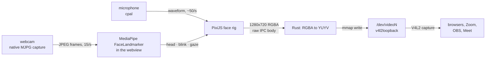

# viicell-face

A Tauri + PixiJS window whose canvas is published as a **virtual camera**, so
any app on the machine (browser, Zoom, OBS, …) can pick the canvas up as if it
were a webcam. The canvas shows a rigged face; its smile sits above a synth line
whose vertical rods dance with the microphone.

The face has two modes: **manual**, where the mouse side buttons and the scroll
wheel pose it, and **facial track**, where the webcam makes it follow your own
head, blinks and gaze. Iris size and pupil width stay on the manual keys in
both.

## How it works



| Path | Role |
| --- | --- |
| `src/face/art.ts` | Artwork from `viicell-faces.svg` and the `Max*Width.svg`/`Min*Width.svg` mouth references |
| `src/face/palette.ts` | Catppuccin Mocha, and which entry each part of the face uses |
| `src/face/paint.ts` | Solid and gradient fills, in shape-local space and cached by description |
| `src/face/backdrop.ts` | The backdrop fragment shader: vignette, aurora, dither |
| `src/face/skeleton.ts` | The bone map: ids, parents and pivots |
| `src/face/rig.ts` | Builds the PixiJS scene from those maps, exposes bones, skeleton overlay |
| `src/face/mouth.ts` | The mic-driven spectrum mouth |
| `src/gaze.ts` | Where the eyes look: the cursor and the pinned screen origin |
| `src/anchor.ts` | The screen origin shared by the cursor and camera modes (unit tested) |
| `src/mode.ts` | Which pose source is in charge: manual or facial track |
| `src/face/tracker.ts` | MediaPipe FaceLandmarker wrapper, calibration collection |
| `src/face/calibration.ts` | The step-by-step calibration: seven poses, each a median or a cursor trace (unit tested) |
| `src/face/landmarks.ts` | Landmarks → head/blink/gaze maths (no runtime dependency, unit tested) |
| `src/face/lowlight.ts` | Local brightness lift for a dim frame before the model reads it (unit tested) |
| `src/face/tracking.ts` | Eases tracked readings onto the rig every frame |
| `src/face/debug_view.ts` | Camera preview with the landmarks and the values read from them (`T`) |
| `src/face/crop.ts` | The preview's face framing: padding, aspect and easing (unit tested) |
| `src/input.ts` | One control stream from the devices or the focused window |
| `src/main.ts` | PixiJS app, frame pump, mode switching, HUD |
| `src/camera.ts` / `src/face_camera.ts` / `src/microphone.ts` | Typed bridges to the Rust commands |
| `src-tauri/src/virtual_camera.rs` | Device discovery, RGBA → YUYV, writer thread |
| `src-tauri/src/face_camera.rs` | Webcam capture, MJPG passthrough, frame slot |
| `src-tauri/src/microphone.rs` | cpal capture, waveform folding, event emitter |
| `src-tauri/src/pointer.rs` | Cursor position from the Hyprland socket |
| `src-tauri/src/input.rs` | Global keyboard and wheel reads for the controls |
| `src-tauri/src/ticker.rs` | Frame timing, so rendering survives a hidden window |
| `src-tauri/src/lib.rs` | Commands, tray, window and mic lifecycle |

Frames are pushed with `invoke("push_frame", uint8Array)`, which makes Tauri send
a raw octet-stream body instead of JSON. The Rust side copies each frame into a
one-slot channel, so a slow device can never stall the webview; extra frames are
dropped and reported in the HUD.

## The face rig

The artboard is 1920×1080 and gets scaled to the 1280×720 output. Every bone is
a transform node parked at its pivot in artboard units, so at rest all
transforms are the identity and the shapes line up with the source artwork.

| Bone | Pivot | Purpose |
| --- | --- | --- |
| `face` | 960, 540 | Root of the face (move/tilt everything) |
| `eyeLeft` / `eyeRight` | iris centre | Eye assembly; scaling Y closes the eye, and it leans with the look |
| `eyeLeftShell` / `eyeRightShell` | iris centre | The blue eye shape |
| `eyeLeftIris` / `eyeRightIris` | iris centre | Dark oval; moving it looks around |
| `eyeLeftPupil` / `eyeRightPupil` | iris centre | Light slit; scaling X dilates it |
| `browLeft` / `browRight` | inner end, y 155.282 | Upper slash; stretched down it becomes a lid |
| `cheekLeft` / `cheekRight` | inner end, y 680.174 | Lower slash; stretched up it becomes a lid |
| `mouth` | 960, 760 | Root of the mouth; scales the whole mouth for width |
| `mouthBottom` | 960, 501.102 | Lower lip; scaling Y opens it, scaling X widens it |
| `mouthTop` | 960, 760 | Upper lip and fangs, over the lower lip |
| `mouthGap` | 960, 760 | The dark cut between the lips, owned by a bone so the mask can be rebuilt |
| `mouthCornerLeft` / `mouthCornerRight` | corner centres, y 674.3 | Each end's cut; scaling it moves that corner from happy to sad |
| `synth` | 960, 1080 | Bottom edge; the spectrum rods live here |

Pose helpers (all return the rig, so they chain):

```ts
rig.setEyeClose(0.5);     // 0 open, 1 shut — squashes the eye to its centre
rig.setBrowClose(0.5);    // 0 rest, 1 brow bottom reaches the eye bottom
rig.setCheekClose(0.5);   // 0 rest, 1 cheek top reaches the eye top
rig.setLook(0.3, -0.4);   // -1..1 per axis, moves both irises
rig.setGaze(0.2, 0.1);    // aim at a point on the screen, 0..1 per axis
rig.setIrisScale(1.4);    // 1 = as drawn; grows/shrinks the dark disc
rig.setPupilWidth(1.4);   // 1 = as drawn; blooms or thins the light slit
rig.setBrowRaise(0.6);    // lifts the outer ends
rig.setCheekLift(0.4);
rig.setMouthOpen(0.5);     // 0 shut, 1 fully open
rig.setMouthWidth(0.5);    // 0 the narrow reference, 1 the wide one
rig.setMouthBottomWidth(0.5);
rig.setMouthCorner("left", 0.5);  // -1 sad cut, 0 flat happy cut, 1 no cut
rig.setMouthCorner("right", -0.5);
rig.resetMouth();         // back to the resting mouth
rig.rest();               // every bone back to rest
```

Anything else is reachable through `rig.bones.<id>.node` (a Pixi `Container`)
or the `Bone` helpers `moveBy`, `scaleBy`, `rotation`, `reset`.

The face is painted from the Catppuccin Mocha palette (`palette.ts`). The shells
run from Sky at the top to Sapphire at the bottom, the irises are a radial
Mantle-to-Crust disc with a Blue rim, and the pupils run Lavender to Sapphire
with a blurred additive copy behind them for bloom. Brows and cheeks are not
painted at all: the brow and cheek paths become one stencil mask per eye, cut out
of a full-artboard shape. A lid therefore removes the eye where it stretches
over it, so the vignette and aurora show through and the shut lid always matches
the backdrop. The mouth is a small rig of its own: the upper line, the lower
lip and each corner are separate bones, and one inverse mask on the mouth root
cuts the gap between the lips into shape. The supplied `Max*Width.svg` /
`Min*Width.svg` references define the range. Width scales the whole mouth, open
scales the lower lip down behind the upper line (eased out, so the visible lip
starts moving with the first bit of jaw travel instead of staying hidden behind
the gap), bottom width widens only the lower lip, and each `mouthCorner` bone
shapes its own end of the smile: the
`LipCorner` cuts start as the flat sliver of the Happiness references, shrink to
nothing at the happiest pose and grow into the round disc of the Sadness
references. The lower lip's extra width fades in with the opening, so a nearly
shut mouth cannot push a wide lip past the gap's corner arms, where the excess
would show above the upper line. Every cut is transparent, so the mouth blends
with whatever backdrop is behind it. The rest pose is a neutral, slightly open
mouth with its corners showing: a smile widens it towards `MaxMouthWidth` and a
frown narrows it towards `MinMouthWidth`, so the tiny narrow mouth is an
expression rather than the default face, and the corners are visible at rest.

Gradients are described in shape-local space (`paint.ts`), so one description
paints both mirrored eyes and follows a pupil as it is scaled. The cached
`FillGradient` instances keep the two halves on the same texture.

The backdrop is a full-artboard quad behind the rig, drawn by a fragment shader
(`backdrop.ts`): a radial lift from Mantle to Crust, two slow Sapphire and Mauve
auroras, and a one-step dither that keeps the shallow gradient from banding in
the YUYV output. `main.ts` advances its clock with the ticker, and `app.extract`
renders the filtered backdrop like any other object.

Press **D** in the window to show the skeleton: a dot on every pivot, a line to
the parent, and the bone ids. The overlay is hidden while frames are read back,
so it never shows up in the camera feed.

Press **T** to show the tracking camera instead: the exact frame the landmarker
last read, with the face mesh, both lids, the irises, the brows and the lips drawn
over it, and a readout of what came out of it — per-eye blink score and lid gap,
gaze, lean, cheek raise, mouth open/width, happy and sad at each corner, brows, and
how the calibration stands.
Each lid is tinted by its closure (mint open, amber half, red shut) so a wink is
unmistakable, and the iris dots are where the model thinks the pupils are. The
picture frames the face automatically: the crop follows the landmark box, tightens
when the face is small and eases along instead of jumping, so the lids and irises
are big enough to read. Losing the face for a few frames keeps the last
crop, then zooms back out to show the whole picture. Outside `mode track` the
preview says the camera is off instead of showing a stale frame. It is a DOM
canvas over the face, so it is never part of the frames read back for the virtual
camera.

## Face controls

Hold a mouse side button, then hold a key and scroll to open, close or resize a
part. The same map is shown in the window, top right, so the controls are
discoverable without this file:

| Key | Part | Scroll up | Scroll down | Tap |
| --- | --- | --- | --- | --- |
| `Z` | brows | open | close | blink |
| `X` | cheeks | open | close | blink |
| `C` | eyes | open | close | blink |
| `V` | iris | grow | shrink | back to drawn size |
| `B` | pupils | bloom | thin | back to drawn size |
| `N` | mouth width | wider | narrower | back to rest |
| `J` | jaw | open | close | back to rest |
| `L` | lower lip | wider | narrower | back to rest |
| `H` | mouth corners | happier | sadder | back to rest |
| `M` | mode | | | switch manual ↔ facial track |
| `R` | tracking | | | run the calibration · retry the camera |

`M` and `R` only do their thing in the mode they belong to: `M` is always
available, `R` recalibrates while tracking. The four mouth keys are manual-only;
in `mode track` the mouth belongs to the tracker. `N`/`J`/`L`/`H` are useful for
checking the rig against the reference SVGs without a camera: scroll `N` to the
bottom for the Min mouth and the top for the Max one, and scroll `H` between the
Happiness and Sadness corners. The lower lip is hidden while the mouth is shut,
so `J` (open) and `L` (lower lip) together reproduce the MaxMouthBottomWidth
reference.

Manual lid keys (`Z`/`X`/`C`) are ignored while the camera is in charge; the
iris and pupil keys, and the gaze origin keys, keep working in both modes.

Bindings combine: hold `Z` and `X` and scroll to move both lids together, or
`V` and `B` to resize the whole eye. Each wheel step moves a lid by 20% (a full
close is five notches) and a size by 8%; the iris runs 0.4–1.6× and the pupil
0.2–2.6× of the artwork. The pupil sits inside the iris, so growing the disc
takes the pupil with it.

The wheel only moves a lid's target. The lid glides onto it with a ~120 ms
easing, so one notch and five land as one smooth motion instead of stepping
frame by frame.

Hold `space` while the eyes are looking somewhere and the gaze holds where it is
while the lean keeps following the cursor: the eyes go on drifting as one piece,
pupils included, but stop looking around. Release it and the gaze glides onto
the live look over a moment instead of jumping. The guide row lights up while
the hold is on.

Every key needs a side button held — either of the mouse's extra buttons. That is
what keeps the face out of the way: without one, `z`, `1` or `d` typed on the
desktop behave exactly as they always did. Releasing the side button mid-pose
finishes it, so nothing is left held.

Closing the brows stretches their lower edge down to the bottom of the eyes;
closing the cheeks stretches their upper edge up to the top of the eyes;
closing the eyes squashes them into their centre. During a blink the iris and
pupil keep their drawn size: the iris is masked by the eye shell, and the lids
cut the whole eye away where they cover it, so the closed part is the backdrop
itself rather than a dark shape laid on top.
A blink always starts from the current manual position, closes fully, and
returns to that position.

## Eye tracking

The pupils follow the cursor across the monitor — not across the app window, and
not only while the window has focus. The origin picks the point of the screen
the eyes look *from*; the cursor drives them either way. The same origin applies
in facial tracking, where it moves the face relative to the screen the same way.
Like every control, the origin keys need a side button held: hold `side`, then
`0`, then `1`–`5`:

| Input | Effect |
| --- | --- |
| move the cursor | eyes look at it |
| hold `0`, press `1` | look from the top left corner |
| `2` | look from the top right corner |
| `3` | look from the centre of the screen (default) |
| `4` | look from the bottom left corner |
| `5` | look from the bottom right corner |
| tap `0` | back to the centre origin |

With the centre origin, a cursor on the left edge is a full look to the left. From
the top-left origin that same cursor sits on the origin, so the eyes look straight
ahead; the far bottom-right corner is the full look. A corner origin therefore
sweeps more gently and reads as a face standing in that corner, watching the
pointer. With no cursor at all the eyes settle on the middle of the screen.

In `mode track` the origin works on the tracked gaze instead: the face still
looks where you look, but it is drawn as if it stood at the chosen corner, so
the middle of the screen is below and to the side of it. The HUD names the origin
in both modes (`eyes camera·top left`).

Each pupil slides as far as its own shell allows, and past it: 40% further left
and right, 2.4× further up and down, because the disc already fills most of the
eye's height and its own rim would leave an upward look reading as barely a
glance. The mask trims the excess, so the pupil presses against the edge instead
of stopping short of it. The blue eye reaches further outward than inward, so the
two pupils do not keep a constant distance from each other: the eye on the side
the face is looking towards travels further, which is what makes the direction
read at a glance. A grown iris has less room, so it travels less.

A look also turns the eye itself: each assembly shifts by up to 16% of its
shell's half-width, or 7.5% of its half-height, in the direction of the glance.
Shell, iris and pupil therefore move as one and the pupil reads as leading a
turning eye rather than sliding inside a still one. The brows and cheeks follow
at 70% of that shift, so the slashes keep their distance from a shell leaning
past them instead of cutting into it. The lean fades as the lids close, which
keeps a shut eye off the lid that is pinned to its rest outline.

On Hyprland the cursor is read from the compositor's IPC socket
(`src-tauri/src/pointer.rs`), normalised into the monitor it is on, and pushed to
the webview. Outside Hyprland (or in a plain browser) the pointer over the canvas
is used instead; the HUD says which source is live: `eyes cursor·monitor` or
`eyes cursor·window`.

## Facial tracking

Tap `M` (with a mouse side button held) to switch to `mode track`. The app then
opens the webcam, runs MediaPipe's FaceLandmarker on its frames and poses the
face from what it sees:

* **lean** — the midpoint of the outer eye corners, relative to the position
  captured during calibration, leans the eyes and carries the brows and cheeks
  at 70% so they do not cut into a leaning shell;
* **blink** — each lid follows its own eye, and two measures are combined: the
  `eyeBlink` blendshape and the geometric gap between the upper and lower lid.
  Both are normalised against the *open* and *shut* poses measured during
  calibration, and the stronger of the two wins. "Open" is the relaxed pose *or*
  whichever screen corner pushed the reading furthest: glancing at a corner
  narrows the lid gap and lifts the blink score, and neither of those is a blink.
  That matters because either measure can be the usable signal: the score
  plateaus at very different heights from face to face
  (a fully shut eye can read 0.6), and on some faces the mesh keeps drawing the
  open eye outline even with the lids together. A score that sits well behind the
  other eye's is ignored, because MediaPipe lifts both during a wink; that is what
  lets a wink close one eye and leave the other open. A reading past 70% is taken
  all the way shut and held for ~110 ms before opening slowly: at 15 fps the peak
  frame lands mid-blink and the score drops again before the lids are actually
  back up. A frown presses the upper lid down a little, which both measures pick
  up; that share of the brow movement is taken back off the closure (fading out
  as the eye shuts), so frowning does not read as half-closed eyes and a blink
  made while frowning still reaches fully shut. The lids drag their brow and
  cheek along;
* **brows** — `browDownLeft/Right` lower each brow towards its eye, so a frown
  reads even when the eyelids are still. From the camera the band stops halfway
  across the eye: the manual keys keep their full travel, but a frown should
  lower the brow, not hide the eye;
* **cheeks** — each cheek follows the cheek itself: the `cheekSquintLeft/Right`
  raise is combined with the mouth corner on the same side and the stronger wins.
  That is what lets a smile with the eyes move the cheek bands, and a one-sided
  grin move only its cheek; the mouth corner stays in as the fallback for faces
  where the model's cheek score stays low.
* **mouth** — `jawOpen` drops the lower lip behind the upper one, the smile
  widens the mouth and the lower lip, and each mouth corner follows its own
  smile and frown: a smile lifts that corner out of its cut, a frown grows the
  cut until the end of the smile is a flat, round sad corner while narrowing the
  whole mouth towards the Min width. The jaw maps straight from the measured
  neutral with no range dead zone, so the first small opening already moves the
  lip. The smile is measured against the same wide-smile pose as the cheeks, the
  frown against the sad pose, and the jaw against the wide-open pose, so all
  three fit this person's range. Until a range is measured — or when the measured
  one is too flat to trust — the mouth falls back on a fixed span, so it moves on
  the first tracked frame instead of waiting for a calibration. A smile wins over
  a frown reported on the same side;
* **gaze** — the head direction *plus* the eyes in their sockets. The head part
  comes from the nose, which sits forward of the face plane: it swings towards
  the side the head turns to and drops when the chin drops, so turning your head
  towards a screen corner moves the gaze there even though the pupils have not
  moved in their sockets. The eye part is the `eyeLookIn/Out/Up/Down` blend
  shapes. The two add up, so the face looks where you look, not merely where
  your eyeballs sit in their sockets. The direction is screen-relative, exactly
  like the cursor mode: looking at the right edge of the screen moves the pupils
  to the right of the picture, even though the camera image itself is not
  mirrored and reports that look the other way round. The cursor-follow step
  measures both parts on your face: while you trace the pointer across the
  screen, a least-squares fit learns how much of a look comes from the head and
  how much from the eyes, and how far each travels. That is what puts the corner
  you look at on the rim of the eye, and the middle of the screen in the middle.

The eyes and cheeks cannot be posed accurately until the camera knows your
range, so the calibration is started by hand: press **Calibrate face** at the
top of the window (or `R` in `mode track`), and the panel shows the tracking
camera with one pose at a time.
The sequence is the middle of the screen with your mouth closed, a cursor
follow, a wide smile, a sad face (mouth corners and brows down), the mouth wide
open, and finally each eye shut on its own: first the eye labelled **L** in the
preview, then **R**.

In the follow step the pointer is the reference: move the mouse slowly out to
every corner of the screen and follow it with your eyes, keeping them open. Each
reading is paired with where the pointer was at that moment, and the fit is
built from those pairs. The step only measures once it has both enough readings
(~4 s of tracing) and a cursor that really went out to all four edges — the bar
stays short while either is missing, so a trace around the middle cannot leave
the screen corners as a guess. That long take also measures the open-eye blink
reading at every direction, which is what stops looking around from reading as
a blink.

Each pose has a **Start**: nothing is recorded until you press it, and the first
~0.8 s after it are ignored so the movement into the pose is never measured. Then
the panel counts and says when the pose is measured; **Next** (or **Finish** on
the last pose) moves on. **Next** always
responds, so a click that came too early says so instead of doing nothing. The
median of each still pose becomes the reference, so every value is measured
against *your* range: 0 at rest, 1 at the pose you held. The smile pose covers
both the mouth corners and the cheeks, so the cheek bands reach their full
stretch and each mouth corner reaches its happiest on your own grin. The sad
pose measures the mouth frown per side and the lowered brows, so the corner cuts
reach their full sad shape; the wide-open pose measures the jaw, so ordinary
speech opens the lower lip without the mouth ever looking slack. That is what
makes a blink reach fully shut even when MediaPipe's blendshape plateaus, and it
is why a pose that was skipped cannot invent one: a signal that did not move is
ignored rather than guessed at.

Each eye is measured shut on its own: the left lid takes its range from the
**L** pose and the right lid from the **R** pose, and the reading of the eye that
stayed open in each is discarded. That gives every side its own shut score and
lid gap, so a wink and a full blink both fit the same lid. Closing the last eye
is the final pose, so there is nothing left to read once it is shut. **Cancel**
(or switching to `mode manual`) leaves the calibration you already had in place,
and the preview is handed back where it was.

MediaPipe names eyes from the subject's side while the rig names them from the
viewer's, and the camera image is not mirrored: `eyeBlinkLeft` drives the rig's
right eyelid, and the landmark groups around 33 and 263 are used accordingly.
That is what makes a wink close the correct eye.

Head position, head direction and gaze are measured against the neutral pose
from the first calibration step, so the face settles wherever you normally sit.
Look at the middle of the screen during that step, so the neutral gaze is the
centre of the monitor. `R` also retries the camera when it could not be opened.

The gaze map has no fixed gains any more: `fitGaze` in `src/face/landmarks.ts`
learns it from the cursor follow, one axis at a time, as an offset per unit of
head turn and per unit of eye movement. If the face cannot reach a corner after
calibrating, the trace was too narrow or too fast rather than a constant being
too low — retrace more slowly, out to every edge.

Iris size (`V`) and pupil width (`B`) stay manual in both modes. The mouth keys
(`N`/`J`/`L`/`H`) drive it in `mode manual`; `mode track` takes it over from the
jaw, smile and frown signals.

The tracked signal is smoothed exactly once (`src/face/tracking.ts`), on every
rendered frame. Each value first passes a dead zone, so the pixel or two of
wobble in a still face moves nothing, then a One Euro filter: heavy low-pass
while the reading barely changes, opening up as it speeds up, so a deliberate
movement is still followed in a few frames. The rig's own pupil easing is
bypassed for camera input (`setTrackedLook`), so the eyes do not trail the head
through two filters. A frame is polled every 30 ms from the native capture slot,
which hands out each new picture once.

The camera is captured in Rust at 640×480 MJPG, 15 fps (`src-tauri/src/face_camera.rs`),
not through `getUserMedia`: WebKitGTK needs its GStreamer capture stack for
that, and page capture also stops while the window is hidden. Frames go to the
webview as raw JPEG bodies (`invoke("face_frame")` → `ArrayBuffer`), so the
landmarker gets a picture without base64 or a JSON byte array. Tracking itself
runs at up to ~15 Hz (about 11–20 ms per frame on this machine); the rig eases
between readings on every rendered frame.

A dim frame is lifted before the model sees it (`src/face/lowlight.ts`). A single
lamp, a monitor's glow or a dark room leaves a face far below the model's
training exposure, and landmarks get shakier with it. Brightness is measured on a
small thumbnail and each region is scaled towards a common exposure, up to 3×:
that lifts the shadow side of a face beside a small light without blowing out
the lit side, which a global brightness change cannot do. A frame that is
already well lit is passed through untouched, and the HUD says `lift ×N` when
the stage did something. The lift only amplifies light the sensor caught — it
cannot invent it, so in real darkness a light on the face (or an IR camera) is
still the thing that decides whether tracking works.

**The webcam is exclusive.** While another app holds the camera — OBS with a
video-capture source, for instance — the app says so under the HUD and leaves
the face alone. Free the camera and tap `R`. Hiding the window keeps the camera
open on purpose, so the face keeps moving while the window is in the tray;
switch back to `mode manual` to release it.

When something does not track the way you expect, tap `T`: the preview shows the
input and the numbers together, so a wrong sign, a lid the model reads as open,
or a neutral pose that was captured mid-blink is visible at a glance instead of
being guessed at from the face alone.

Set `VIICELL_FACE_DEVICE=/dev/videoN` to pick a camera, and
`VIICELL_MODE=track` to start the app already tracking.

## Global keys

Wayland has no shortcut API that also carries the scroll wheel, so the controls
read `/dev/input/event*` directly (`src-tauri/src/input.rs`). That needs a
one-time permission grant:

```sh
sudo scripts/setup-input-access.sh
```

It installs a udev `uaccess` rule, so only the user with the active desktop
session can read those devices. Undo it with
`sudo rm /etc/udev/rules.d/70-viicell-face-input.rules && sudo udevadm control --reload-rules`.
The app picks the devices up on its own; the HUD switches from `keys window` to
`keys global`. Without the rule everything still works while the window has
focus, and a line above the HUD says
`global keys off — run sudo scripts/setup-input-access.sh` so the missing grant
is not mistaken for a bug in the controls.

Reading the devices is passive — it cannot stop a key from reaching the focused
app, and grabbing the keyboard to do so would stop you typing at all. So the
controls sit behind the mouse side buttons instead: nothing moves the face unless
a side button is held. While you are posing, the held key and the wheel still
reach the focused window, and the side buttons themselves keep their usual job,
which in a browser is back and forward.

## The synth mouth

The synth line is not a static shape: a capture thread folds each window of
input samples into 160 points and pushes them to the webview as `mic-wave`.
The webview runs those samples through one DFT probe per rod, spaced
logarithmically across the voice range, so the mouth reads like an old radio or
DJ analyser. The artwork's thin band is the plinth and 114 slim rods rest on it.
The plinth reads Sapphire to Mauve across the screen; each rod runs from a
Lavender tip down to the band, and the falling peak cap is Lavender too.

Silence leaves every rod at the height it is drawn at, reproducing the artwork's
row of short bars. Each rod has a fast attack and a slow release with a falling
peak cap, levels are smoothed across neighbouring bands, the gain reference
follows the loudest band slowly, and a noise floor gate keeps room noise from
lighting the display.

Audio is captured in Rust (`cpal`) rather than with `getUserMedia`: WebKitGTK
needs a full GStreamer install to capture media, and the native path also keeps
working while the window is hidden. Without a microphone the synth line simply
draws its resting bars and the HUD says `mic off`.

## Requirements

Linux with:

* [`v4l2loopback`](https://github.com/umlaeute/v4l2loopback) for the virtual
  camera (`sudo pacman -S v4l2loopback-dkms` on Arch based systems).
* ALSA for the microphone (`alsa-lib`, already required to build `cpal`).
* A webcam (MJPG capable) for the facial-tracking mode. The MediaPipe WASM
  runtime and the FaceLandmarker model ship with the app in `public/`
  (`scripts/sync-mediapipe.sh` refreshes them), so tracking works offline.

### Wayland and DMA-BUF

On some driver/compositor combinations (NVIDIA on Hyprland, for instance)
WebKitGTK's DMA-BUF renderer tears down the Wayland connection while the window
is created, so the app exits immediately with:

```
Gdk-Message: ... Error 71 (Protocol error) dispatching to Wayland display
```

To avoid that, the binary sets `WEBKIT_DISABLE_DMABUF_RENDERER=1` for Wayland
sessions before GTK starts; the shared-memory path renders the webview and its
WebGL canvas correctly. Set `VIICELL_DMABUF=1` to opt back into the zero-copy
path, or set `WEBKIT_DISABLE_DMABUF_RENDERER` yourself (an explicit value always
wins over the default).

The app streams into any existing loopback device. To give it a dedicated one
(so camera pickers show `viicell-face` instead of whatever the first loopback
device is called), run once:

```sh
sudo scripts/setup-virtual-camera.sh
```

The script merges the device into the current `v4l2loopback` configuration,
reloads the module and verifies that the camera appeared. It is optional: the
app falls back to the first loopback device it finds.
`VIICELL_VIDEO_DEVICE=/dev/videoN` forces a specific device.

## Development

```sh
bun install
bun run tauri dev     # app + vite dev server
bun run tauri build   # bundle
bun test              # tracking maths
(cd src-tauri && cargo test --lib)
```

The `cargo test` run includes two ignored tests that need real hardware:
`captures_a_frame` opens the webcam (run it with `--ignored`).

The HUD in the bottom-left corner shows the device, format, measured output rate
and the microphone state. If no loopback device is available, a panel explains
what to run.

## Window behaviour

Closing the window does not quit the app: it keeps running from the tray and
keeps streaming the canvas, so you can hide the control window while other apps
keep using the camera.

* **Left click** on the tray icon opens the menu with **Open viicell-face** and
  **Quit viicell-face**. Linux tray hosts do not deliver click events to the app,
  so the menu is the way back in; on Windows/macOS a left click reopens the
  window directly and the menu opens on right click.
* **Quit** releases the v4l2 device before exiting, so consumers see the camera
  go idle instead of a frozen stream.
* If the webview stalls (hidden window, another workspace), the writer repeats
  the last frame at the configured rate, so the device never stalls. Rendering
  itself is driven by `src-tauri/src/ticker.rs` rather than
  `requestAnimationFrame`: a window that is not on screen never gets compositor
  frame callbacks, so rAF would drop the face to about 1 fps there.

## Changing the output

Resolution and frame rate live in `src/config.ts`; keep the width/height even
(YUYV 4:2:2 needs pixel pairs) and within the device's `max_width`/`max_height`
(1920×1080 with the recommended setup).

The artwork lives in `src/face/art.ts` (paths and fills) and
`src/face/skeleton.ts` (pivots/parents). Re-exporting `viicell-faces.svg` means
copying the changed path data into `art.ts` — the rig addresses each piece
individually, which a single SVG texture could not do.
